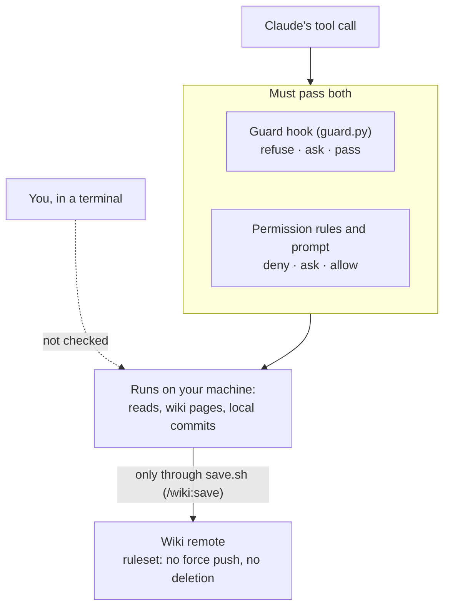

# Security model and guard

A wiki session lets Claude read your sources, write wiki pages and commit them. This page says what keeps that session from changing the sources, the guard machinery or the remote, what the guard blocks, and its known false positives and gaps. The reasons behind the design are in `docs/adr.md`, 3.

## The model

There is no OS sandbox: Claude runs with your file system and network access. What protects a wiki is four layers, each matching what a tool call says:

1. **Permission rules**, in the wiki's `.claude/settings.json` (from `templates/project-settings.json`, plus the deny rules `sources.sh settings` writes for each source's MCP write tools).
2. **The guard**, a PreToolUse hook (`guard.py`) that sees every tool call and refuses, asks or lets it pass.
3. **Claude Code's permission prompt**, for what the guard leaves to you, and for the guard's "ask" reply.
4. **The remote's ruleset**, which refuses force pushes and branch deletion (`docs/setup.md`, "Optional: the wiki on GitHub").

**What is protected:**
- the sources stay read-only;
- the guard machinery (the plugin, the wiki's settings and source files) can't be changed by the session it guards;
- nothing reaches the remote except through `/wiki:save`;
- files that run code later (git hooks and config, MCP servers, the wiki's skills and agents) stay as you made them;
- no nested Claude session runs without the guard.

**Against what:** Claude's accidental or straightforward misuse. The guard matches command text, so it is a guardrail, not a security boundary: a deliberately obfuscated command can get through.

**Not covered:** anything you run by hand, sessions outside a wiki, and reads in general (only `agent_only` sources are kept from the main session). If a change to a source slips through, recover it there, e.g. with Proton's Trash and version history.

## How the guard works

- **Every tool call goes through it** (hook matcher `*`). `hookjson.py` sorts each tool into shell (Bash, PowerShell, Monitor), write (Write, Edit, MultiEdit, NotebookEdit), read (Read, Grep, Glob), harmless (its `HARMLESS` list, passed unread) and MCP (`mcp__*`, passed unless the table below says otherwise). **Any other tool is refused**, LSP included, until it is added to that list.
- **Checks run in order; the first refusal wins.** `git push` is checked first, so no exception can let one through.
- **It fails closed:** input it can't parse, a shell call without a command, a write call without a path, or a crash of the guard itself blocks the call. While any source contract or instance can't be used (no frontmatter, an unknown type, a local type shadowing a standard one, a filesystem instance without roots, a reader binding that doesn't parse, a name that isn't kebab-case, a folder that can't be listed), every shell and write call is refused except plain `git status`/`log`/`diff`/`show` (no `--output`) and `sources.sh list`/`show`/`contract`, and so is every MCP tool a reader list names. Read still works. The message names the file; you fix it with `install-source-file.sh` or an editor.
- **Script calls are the way through.** A plain `bash <plugin>/scripts/<script>.sh <args>` (a core script) or a call of a wrapper a contract lists under `scripts` passes the path, word and root checks: one call per Bash call, no `; & | < > $`, backtick or `..`. The message for a chained call says so.
- **Shells:** the wiki's scripts run only through the Bash tool (Git Bash on Windows). PowerShell gets the same checks without the script exceptions. Monitor's command is checked as a Bash command; a Monitor WebSocket watch (no command) passes.
- **Left to the permission prompt:** `git config` and `git -c` (a key such as `core.hooksPath` or a `!` alias can run commands), and a Monitor WebSocket watch.

## What the guard blocks

"Shell" means the command's text: a path is matched in every spelling (`~/…`, `$HOME/…`, `$env:USERPROFILE/…`, `C:/…`, `C:\…`, `/c/…`). "Write" resolves the path, `..` included, before checking it.

| Guard | Tools | Blocks | Allowed instead |
|---|---|---|---|
| **The sources stay read-only** | | | |
| Guard words | shell, write | a command containing any contract's guard word (e.g. `proton-drive`); non-Markdown content containing one | the source's wrapper script, as its `SOURCE.md` says |
| Filesystem roots | shell, write | a command naming a filesystem instance's root (e.g. `~/Documents/Scans`); a write inside it | as its `SOURCE.md` says: a wrapper script, or Read, Grep and Glob |
| `agent_only` sources (e.g. `codebase`) | read, shell | in the main session: Read, Grep or Glob on the root, a command naming it, and a wrapper operation not in the contract's `main_ops` | a subagent, as `/wiki:research` dispatches |
| Reader limits | MCP | a tool a reader binding names only with limits (`name=listJiraProjects`), called without one of their values | the operations the binding names |
| Lookalike scripts | Bash, Monitor | a core-script name or `*/sources/<type>/*.sh` outside the plugin (the settings allow wrappers by wildcard) | the plugin's own copy |
| **The guard machinery** | | | |
| Plugin and source files | shell, write | a command naming the plugin's folder, `plugins/wiki/scripts`, `hooks` or `sources`, `.claude/sources`, `.claude/settings` or `.claude/plugins`; a write anywhere in the plugin folder (skills, schema and templates too) | Read, Grep and Glob; you edit these files |
| The plugin's clone | shell, write | when the plugin is `plugins/wiki` of a git clone (a cloud session's `/opt/wiki-tools`, a local checkout), a command naming or a write anywhere in that clone, so a session can't check out another commit or change `.git/` (`docs/adr.md`, 19) | Read, Grep and Glob |
| **The remote** | | | |
| `git push` | shell | a command with the word `git` followed by `push` (only `git stash push`, written exactly so, passes) | `/wiki:save` when saving is on (the message says so); otherwise you push |
| GitHub MCP tools | MCP | every tool of a server whose name contains `github` (`push_files`, `merge_pull_request` push past git) | as for `git push` |
| `gh` writes | shell | `gh api`, `pr`, `repo`, `release`, `workflow`, `secret`, `variable` or `gist` as a command, reads included | other `gh` subcommands (`gh issue list`); a source's `gh` wrapper |
| `save.sh` | shell | any command naming `save.sh` other than a plain call of the plugin's copy; `--allow` from Monitor or PowerShell, or with anything but 1 to 50 plain paths; any command naming `WIKI_SAVE_TEST_*` | `save.sh --check`, `--update`, `--unattended`; `save.sh --allow <paths>` from Bash, which asks you, listing the paths |
| **Files that run code later** | | | |
| Git, MCP, skills, agents | shell, write | a command naming or a write to `.git/hooks`, `.git/config`, `.mcp.json`, the wiki's `.claude/skills` or `.claude/agents` | your own `~/.claude/skills` (a reader may live there); you edit and commit these files |
| **No unguarded session** | | | |
| Nested Claude | shell | `claude` as a command word (paths such as `.claude/` and text pass) | you run `claude` in a terminal |

Every tool call launches the guard: about 28 ms on Linux, mostly starting Python. Windows is slower.

## Known false positives

| Blocked | Why | Do this instead |
|---|---|---|
| A commit message containing "push", a guard word or `save.sh`, or a line starting `gh pr …` or `claude …` | the guard matches the whole command's text | rephrase the message |
| `git -C <dir> stash push` | `git -C stash push` is a real push | `git stash`, or `cd` first |
| `git add .claude/settings.json` (or `.claude/sources`, the wiki's `.claude/skills`, `.claude/agents`, `.mcp.json`) | a protected path in the command | commit those files yourself |
| `cat .claude/settings.json`, `cat .git/config`, `ls .claude/skills` | the same; there is no exception for commands that only read | Read, Grep or Glob |
| `git log -- plugins/wiki/scripts/lint.sh`, `git -C /opt/wiki-tools rev-parse HEAD`, or `git show` or `git diff` naming a protected path | the guard can't tell a harmless `git log` from `git log --output=…`, `git -c core.pager=…` or `git diff --ext-diff` | Read, Grep or Glob; for the plugin's history, a terminal or a session in the wiki-tools clone |
| `git commit -m "…" && bash <plugin>/scripts/sources.sh due` | a script call must be plain, one per Bash call | run the script as a Bash call of its own |
| `grep -E "(gh api\|gh pr)"` | `gh` after `(` looks like a command | search for the words separately |
| `ls ~/Scans-old`, for root `~/Scans` | the path starts with a root | Read, Grep or Glob |
| A reader from a plugin installed with `claude plugin install` | it runs from `~/.claude/plugins/cache/…`, and `.claude/plugins` is protected | load it from a local clone (below) |

**Readers from plugins:** add the plugin's marketplace as a directory (`claude plugin marketplace add <clone>`) and enable the plugin in `~/.claude/settings.json` (`"enabledPlugins": {"<plugin>@<marketplace>": true}`) without `claude plugin install`. Claude Code then runs it from the clone, as it does `wiki` (observed, not documented); check in a session that the skill's folder is the clone. A guard exception for declared read-only plugin commands is parked in `docs/roadmap.md` ("Readers from installed plugins").

## Known gaps

What gets past a guard, beyond a command the shell assembles from pieces (a variable, `eval` of a built string):
- **Nested Claude:** `claude` inside a string another shell runs (`bash -c 'claude …'`), after `sudo` or `npx`, or after a wrapper option that takes a value (`timeout -s kill 10s claude`).
- **`gh` writes:** `gh` after `npx`, `watch`, `find -exec`, `cmd /c`, `Start-Process` or `iex`, after a leading redirection or a wrapper option that takes a value (`env -u X`, `sudo -u x`); a `gh` alias or extension; the GitHub API without `gh` (`curl`).
- **`save.sh`:** the script's or a test setting's name built from pieces; a test setting that reaches the session another way (the settings' `env`). The test settings only redirect a save to a local `file://` repository.
- **`git config` and `git -c`:** not checked; your permission prompt decides.
